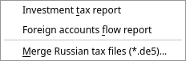
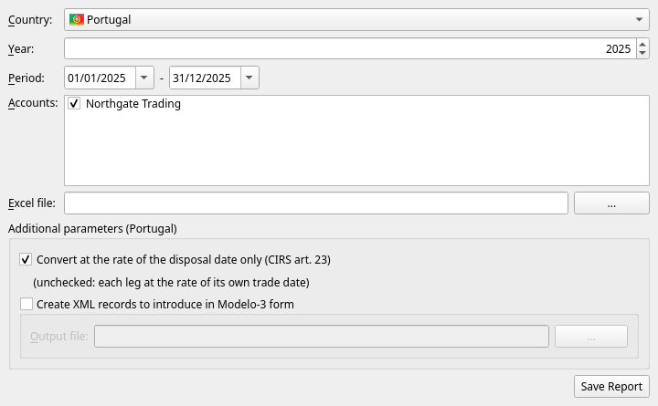
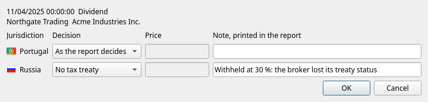
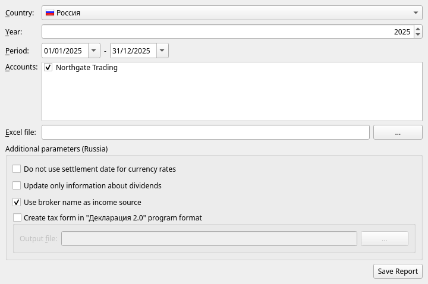
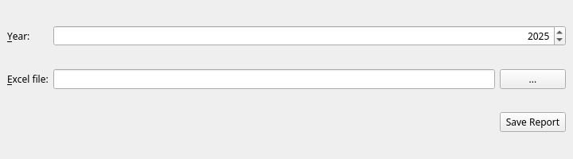

[← Reports](10-reports.md) | [Contents](README.md) | [Next: Settings and maintenance →](12-settings-and-maintenance.md)

# 11. Tax reports

> **JAL is not a tax adviser and neither is this manual.** What follows describes the buttons and the
> files they produce. Whether the figures are the ones your tax office wants, and how they should be
> declared, is between you and the rules of your country — check the result before you file it.

JAL can prepare investment tax figures for **Portugal** and **Russia**, from the operations on one or
several investment accounts, for a calendar year or a part of one.

## What it produces

**Tax → Investment tax report**:

| Field | What to set |
|---|---|
| **Country** | Portugal or Russia |
| **Year** | The tax year. Defaults to last year, which is usually the one being declared. |
| **Period** | The days of the year the report covers — the whole year unless your [residence](#part-of-a-year-and-residence) says otherwise. You can type other dates; they stay inside the year. |
| **Accounts** | The investment accounts to report on, all ticked. Only investment accounts with something taxable in the period — a sale, a swap, an income, a fee — are listed. Untick an account to leave it out, for example one with a bank of the report's own country whose figures the tax office already has. See [Several accounts](#several-accounts). |
| **Excel file** | Where to write the detailed report. |

Press **Save Report** and JAL writes a spreadsheet with one sheet per kind of income — shares,
bonds, dividends, crypto, fees — arranged by the **tax bases** of the country (below). Each line shows
the amounts in the account's currency, the exchange rate used, the amount in the tax currency and the
code the declaration asks for. It is meant to be readable: an inspector (or you, next year) can follow
every figure back to the operation it came from. A sheet with nothing on it is left out, and lines
under a sheet's title state the rules it was built on: how deals are matched, which rate is used,
what counts as the cost, what JAL assumed about the law.

### Part of a year and residence

A report covers the days between **From** and **To**: an operation dated outside them is left out,
while the rules of the year — its [parameters](#tax-parameters), its codes, the treatment of
[short sales](#short-sales) — stay those of the whole year. The header of every sheet states the
period.

When you choose a country or a year, the dialog proposes the period in which that country holds you
resident, worked out from the **residence** table (**Data → Residence**, see [chapter 3](03-first-steps.md)), and names it under the
dates:

* **Russia** knows no part of a year: 183 days or more in Russia make the whole year, fewer make none.
* **Portugal** counts from the date of each row: a move to Portugal on 11 September gives
  11 September – 31 December. Leaving and coming back gives two periods; the dates are set to the first.

The table stands in for where you really were: JAL counts its rows, not your days of presence. If the
table gives nothing for the year, the whole year is proposed. Your own dates stay until you change the
country or the year.

If another country holds you resident in the same days — a move from Russia to Portugal in September
leaves Russia the whole year and gives Portugal the autumn — the dialog names it too (*Also resident
in …*). Both countries' reports are then legitimately made on the same operations, each by its own
rules; JAL does not decide which country's claim wins under a tax treaty, nor credit one tax against
the other.

A change of residence does not change what your holdings cost: every deal keeps its **historical
acquisition cost** and date, and the sheets of sales say so.

### Several accounts

With more than one account ticked, one report covers them all, and the replay of the lots is done once:

* every sheet shows each account's lines under a line naming the account, its currency and its broker,
  with the account's own total after them, then a **total of all the accounts**;
* if the accounts' currencies differ, that total leaves the account-currency columns empty and the
  column headers say *account currency* — only the figures in euros or roubles are added up;
* deals are still matched within each account, never across accounts (the line under the sheet's
  title says so), and the results of the accounts are **netted** on the Summary sheet — a loss on one
  account reduces a gain on another within a tax base, and the [base estimation](#base-estimation) is
  made on that netted total;
* the declaration files take every account's lines, each under its own broker, country and currency.

### Tax bases

The law declares some kinds of income apart from others, and a loss on one kind does not reduce a
gain on another. The report follows that division: the sheets are grouped by base, and the Summary
gives a total per base.

* **Russia** — separate bases, none of them netted with another: securities (shares and bonds
  together, coupons included), derivatives, dividends, interest, crypto and crypto income. JAL
  cannot tell derivatives on securities from other derivatives, so they stay on one sheet beside the
  securities and are not added to them; and it treats every security as traded on an organized market.
* **Portugal** — two categories: **G**, one balance of shares, bonds, derivatives and crypto held
  under 365 days, where a loss on one offsets a gain on another; and **E**, dividends and interest,
  each taxed gross. Crypto held 365 days or more is excluded from tax and listed apart, for the
  declaration's information annex.

Losses of earlier years are not carried into the report — that is for the declaration.

### The sheets

In the order they are written:

| Portugal | Russia | Base | What is on it |
|---|---|---|---|
| Summary | Сводка | — | The totals of each base — see below. |
| Shares | Акции | G · securities | Sales of shares and funds. In Portugal also the shares given up in a merger into a company outside the EU, as a disposal (*Permuta*) — see [How each country sees an exchange](#how-each-country-sees-an-exchange). |
| Bonds | Облигации | G · securities | Bond sales and redemptions. In Russia the coupons and accrued interest too; in Portugal they go on Interest. The Russian price is per bond, in the trade's currency. |
| Derivatives | ПФИ | G · derivatives | Options, futures and other derivatives closed in the year. |
| Crypto < 365 days | — | G | Crypto sold for money after less than 365 days. |
| Dividends | Дивиденды | E · dividends | Dividends and the tax withheld at source. The Russian sheet adds the tax still to pay, as a [base estimation](#base-estimation). |
| Interest | Проценты | E · interest | Interest the broker paid and cash from corporate actions; in Portugal also bond coupons and accrued interest received. The Russian sheet names the payer and its country, and adds the tax as a [base estimation](#base-estimation). |
| — | Криптовалюты | crypto | Crypto deals: every sale, and every exchange of one coin for another. |
| — | Криптодоход | crypto income | Staking rewards, lending interest and other crypto received as income, valued on the day it arrived. |
| Crypto ≥ 365 days | — | outside | Crypto sold for money after 365 days or more: excluded, still to be declared. |
| Crypto income | — | outside | Crypto received as income, for information only: it opens a lot at zero cost and is taxed when sold. |
| Fees | Комиссии | outside | Fees not linked to a deal — depositary (ADR) fees, position financing, other asset fees — grouped by kind. No base takes them; whether and where to claim them is up to you. |
| Not covered | Не отражено | — | Everything taxable that no other sheet shows — see below. |

In Portugal a crypto-for-crypto exchange is never a sale, so only sales for money appear; in Russia
every exchange is one. How each country values them is [below](#how-each-country-sees-an-exchange).

### Short sales

Both reports follow the strict reading of the law: a short sale is reported in the year of the
**sale**, and a buy-back in a later year is not deducted from it. A stock sold short in December and
bought back in January — or still open — appears in December's year with its proceeds less the fee of
the sale and no acquisition cost; the next year's report lists the buy-back on **Not covered** and
deducts nothing. For Russia the year is that of the settlement: a short sold on 30 December and
settled in January belongs to January's year. A short sold and bought back within one year is an
ordinary deal. This is why it has always been advised to close shorts before the end of the year.

Only **stocks** follow this rule. A short of anything else — a fund, a bond, an option, a CFD,
a coin — that is open across the end of a year is not handled: the Summary sheet and a message after
saving name it, and you have to check it by hand.

**The cost of a deal is what was paid, in the currency it was paid in.** Moving shares or coins
between your own accounts in different currencies does not change it: a coin bought for roubles and
sold on a euro exchange costs, in the report, the roubles it was bought for, and the line says so.

### Codes

The last column of a sheet holds the code the declaration asks for, from the
[parameter file](#tax-parameters) of the year:

* **Russia** — the income and deduction codes of the official list, e.g. 1530 / 201 for securities,
  1532 / 206 for derivatives, 1010 for dividends, 4800 for interest. The crypto codes (6035 / 435,
  and 4800 for crypto income) are not in that list yet; the sheet says so — check them before filing.
* **Portugal** — the codes of Annex J: G01 for shares, G20 for funds and ETFs, G10 for bonds, G30
  for derivatives, E11 for dividends, E21 for interest. Crypto has no code: the sheet names the table
  it goes in (Annex J 9.4A, or Annex G1 table 7 for crypto held 365 days or more).

An account with a bank or broker of the report's own country (a Russian broker in the Russian report,
a Portuguese one in the Portuguese report) gets no codes: tax is withheld there and the tax office
receives the figures pre-filled. The sheet says so. The declaration files below still include them.

### Summary and "Not covered"

The **Summary** sheet has a heading per tax base, the sheets of the base under it with their figures,
and a total for the base: for sales the acquisition cost, the disposal value and the gain or loss, as
the declarations ask for them; for income its gross amount. Bases are never added to each other —

* except on one line of the Russian Summary: the **sum of the bases taxed at 13/15 %** (securities,
  derivatives, dividends, crypto, and interest from Russian payers), since that rate depends on their
  sum. Each base counts with its sign, a loss included. It is a sum of bases, not a tax.

The sheets outside every base follow, listed with their amounts and never totalled. Then come the
lines to read before filing:

* **Skipped by the jurisdiction's rule** — operations a sheet leaves out on purpose, each with the
  reason: in Portugal a crypto-for-crypto exchange is not taxed until the coins are sold for money
  (CIRS art. 10.º, n.º 20), and accrued interest paid when buying a bond is not deducted; in both
  countries a returned token-account rent is a refund, not income.
* **Not included in any section** — taxable operations JAL has no sheet for yet, such as a spin-off
  or a deal in a fund. They are listed on **Not covered** so that nothing disappears silently;
  how to declare them is up to you.

Below the counts come the [base estimations](#base-estimation) of tax, one line per tax base on sales and
per sheet of income that has one, then any warning — rates probably missing, [parameters](#tax-parameters) not reviewed for the year — and
last the list of [your decisions](#your-decisions-tax-treatment) the report applied.

### How each country sees an exchange

JAL books an exchange its own way: a swap you recorded as a sale realizes a result, while a swap
recorded *without a result*, a wrapping (ETH → WETH), a supply to or a withdrawal from a lending
protocol, and a corporate action carry the cost of the old asset onto the new one. Countries read
these differently, and a different reading changes not only the exchange but every later sale of what
it gave you. So each report **replays the whole history of your lots under its country's rules**,
all accounts and all years, and takes its figures from that replay. Your own ledger, holdings, Deals
and profit and loss are not touched — they stay as JAL books them.

* **Russia** — every swap and every wrapping, the supply and withdrawal of a lending protocol
  included, is a **sale at market value**: the old coin's quote of that day, or the new coin's if the
  old one has none. The coin received starts at that value, on that day. Crypto received as income
  starts at its quote on the day it arrived — the value the Криптодоход sheet taxes — so a later sale
  is not taxed on it twice. Corporate actions are carried as JAL books them.
* **Portugal** — a crypto-for-crypto exchange or a wrapping is no sale: the coin received **keeps the
  cost of the coin given**, through any number of exchanges, back to the purchase for money — but its
  **365-day holding period starts again** at each exchange (CIRS art. 10.º, n.º 20). A sale may
  therefore move between the *Crypto < 365 days* and *Crypto ≥ 365 days* sheets compared with JAL's own
  view. Crypto received as income starts at zero. Shares exchanged in a **merger into a company outside
  the EU** are a disposal (article 10.º, n.º 8 covers EU companies only), valued per new share at the
  higher of the old shares' last quote times their part of the cost, and the new shares' first quote;
  the new shares start at that value. A spin-off is no disposal: the cost is split as the corporate
  action states, and the Shares sheet says so.

The replay takes time — around **20 seconds** per report on a ledger of several years. A progress bar
on the status bar shows it; **Stop** ends the report without writing anything. The tax window stays
locked until it is done. If an exchange the country treats as a sale has no quote to value it, the
report stops and names it.

### Currency rates

Each report converts with the official rates of one bank only, as the law requires: **Portugal**
uses the European Central Bank's (they equal the Bank of Portugal's), **Russia** the Central Bank of
Russia's. JAL never builds a rate from another bank's rates. Where a bank stopped publishing a
currency, its last rate stays the valid one — the ECB's rouble rate of 1 March 2022, for example.

* If a rate the report needs is not in the database at all, JAL stops and lists the missing rates
  and quotes; add them and save the report again.
* If the latest stored rate is more than two weeks older than an operation, and either that
  currency has a later rate (a hole in the series) or none of the bank's rates reach that day (they
  were not downloaded), the rate is probably missing. JAL still makes the report on the older rate,
  but warns of it in a message and on the Summary sheet; download the rates and save the report
  again. A currency the bank froze while still publishing the others is no warning.

### Tax parameters

What a report needs to know about the law of a year — which countries have a tax treaty with the
jurisdiction, the base tax rate of each kind of income, the [code](#codes) of each kind of line —
comes from a parameter file shipped with JAL, one per country. Each value holds from the year it starts to apply until the year it changes, and the
file says up to which year it was last **reviewed** against the official sources.

* A report for a year **after** the review is still made, with the latest values known; a line on the
  Summary sheet and in the message after saving says so. The law may have changed since — check.
* A report for a year **before** the file begins assumes no treaty and computes no base estimation;
  the Summary sheet and the message say that too. The Russian file starts in 2020.

### Base estimation

Some figures are JAL's estimate rather than a fact from the broker: in the Russian report, the
dividend tax still to pay and the tax on interest; in both reports, the tax on each base of sales on the
Summary sheet; and the tax column of the
[tax estimate](06-investments.md#what-a-sale-would-cost-in-tax) window. Each of them is a **base
estimation**: the base rate of the year from the [parameters](#tax-parameters), applied to the income
and nothing more —

* no progressive bracket, no deduction, no netting with other sheets — only the accounts ticked
  together in one report are netted;
* for a dividend, the tax withheld abroad is subtracted only where a tax treaty applies, and never
  below zero;
* for sales, one estimate per base, on its total: in **Russia** securities (shares and bonds together),
  derivatives and crypto, each apart — derivatives are not netted with securities, as JAL cannot tell
  derivatives on securities from the others; in **Portugal** the one balance of category G, crypto held
  365 days or more left out. A loss counts as zero and reduces no other base.

It is printed in italics on a pale amber background, the column header says *базовая оценка* /
*base estimation*, a line under the sheet's title states the rate, and the Summary sheet adds the
estimations up. It is a guide to the order of the amount, **not** the tax you owe: the
declaration computes that.

### Your decisions (tax treatment)

JAL's rules cannot know everything about an operation: a "dividend" that was really a return of
capital, a dividend on which the broker could not apply the treaty. Right-click the operation in the
operations list and choose **Tax treatment…**:

There is one row per country. Choose a decision and write a note — the note is required, as it is
printed in the report next to the decision:

* **Not a tax event** — that country's report leaves the operation out of its sheet and its totals,
  and lists it last on **Not covered** with your note. On an exchange — a swap, a wrapping, a corporate
  action — it also makes the [replay](#how-each-country-sees-an-exchange) carry the cost and the date
  through it, so that the gain is taxed when what you received is sold.
* **A tax event** — offered for an exchange the country's rules carry (a crypto exchange in Portugal, a
  corporate action in Russia): the replay sells the old asset at market value — for a corporate action,
  the estimate described above — and the new one starts at that value.
* **A tax event at a price per received share** — offered for a corporate action into one other asset:
  enter the price in the **Price** column; the old shares are sold, and the new ones start, at that
  price times the shares received. Use it where the market value is known, e.g. from the exchange ratio
  and a reference price.
* **Tax treaty applies** / **No tax treaty** — offered for dividends only: that country's report
  takes your answer instead of its treaty list, for the treaty column and for the
  [base estimation](#base-estimation).
* **Source: the asset's country** — offered for a corporate action that paid cash, in the Russian row
  only: the Проценты line names the company and its country as the payer instead of your broker, and
  that country decides whether the line counts among the 13/15 % bases. If the asset has no country,
  the report stops and asks for it.
* **As the report decides** — removes the decision.

A decision belongs to one country: the other country's report does not see it. An operation that has
one shows the tax icon at the right end of its notes in the operations list, and the decisions in the
tooltip of its first three columns. Each report lists every decision it applied at the end of its
Summary sheet.

### The country options

**Portugal**

* **Convert at the rate of the disposal date only (CIRS art. 23)** — on by default: the cost, the
  proceeds and the expenses of a deal are all converted at the rate of the day it was sold, as
  article 23 of the CIRS describes. Unchecked, each leg is converted at the rate of its own trade
  date. A short sale is converted at the rate of the sale that opened it; that is JAL's reading,
  not a confirmed rule, and the line says so.
* **Create XML records to introduce in Modelo-3 form** — also write an XML file with the lines of
  Annex J: table 9.2A for shares, funds and bonds, each with its code, and table 9.2B for derivatives.
  A short sale is written as realized by the sale that opened it; a stock short open at the end of
  the year is left out of the file — enter it by hand (see [Short sales](#short-sales)). The 9.2B
  lines are a first draft — check them against the form before loading them. Crypto is not in the
  file yet: enter it from the crypto sheets.

**Russia**

* **Do not use settlement date for currency rates** — take rates from the trade date instead of the
  settlement date.
* **Update only information about dividends** — fill in the dividend sections of the declaration only.
* **Use broker name as income source** — name the broker, rather than the issuer, as the source of
  income.
* **Create tax form in "Декларация 2.0" program format** — also write a declaration file for the
  official program (its extension carries the year: `.de5` for 2025, `.de6` for 2026), with the codes
  of the parameter file. It holds dividends, securities, derivatives and interest; crypto is not in it
  yet.

## Money flow report *(Russia)*

**Tax → Foreign accounts flow report** produces the report on movements of money through a foreign
account that Russian residents must file:

Choose the year, choose where to save the spreadsheet, press **Save Report**.

## Merging declaration files

**Tax → Merge Russian tax files (\*.de5)** joins several `.de5` declaration files into one — for when
different sources of income were prepared separately and have to be filed together. Add the files
with **+**, name the output file, press OK. For JAL's own accounts it is simpler to tick them all in one
report ([Several accounts](#several-accounts)): its file already holds every account's lines.

## Before you file anything

* **Download prices and rates for the whole year first.** Every conversion uses a rate JAL has
  stored: a missing one stops the report, a probably missing one gives a warning (see
  [Currency rates](#currency-rates)). See [chapter 9](09-importing.md).
* **Read the Summary sheet**, and the **Not covered** one if it is there — including its warnings
  about [parameters](#tax-parameters) and the list of [your decisions](#your-decisions-tax-treatment).
* **Check the [codes](#codes)** against the declaration of the year, the crypto codes above all.
* **Look for shorts open at the end of the year** — see [Short sales](#short-sales).
* **Check that the account reconciles.** If JAL's closing balance matches your broker's, the
  underlying data is probably complete.
* **Check the corporate actions.** JAL refuses to build the ledger past a corporate action whose
  cost shares do not add up to 100 %, but it cannot tell whether shares that do are right: a wrong
  split of cost quietly produces a wrong profit, and can move it into another tax year. Compare each
  spin-off and merger with the figures the company published —
  see [chapter 6](06-investments.md#corporate-actions).
* **Read the log** after producing the report.
* **Keep the files you file.** A report is worked out afresh every time from what the database holds
  now: a rate downloaded later, a statement imported again or a rebuild of the ledger can change the
  figures of a year already declared, and JAL keeps no copy of what it produced. Store the spreadsheet
  and the declaration file you filed, and compare a later report with them yourself.

For Interactive Brokers there is a detailed, step-by-step example (in Russian) of preparing a Russian
declaration, in the project repository:
[docs/ru-tax-3ndfl/taxes.md](https://github.com/titov-vv/jal/blob/master/docs/ru-tax-3ndfl/taxes.md).

---

[← Reports](10-reports.md) | [Contents](README.md) | [Next: Settings and maintenance →](12-settings-and-maintenance.md)
