### Инструкция по подготовке данных для декларации 3-НДФЛ для Interactive Brokers

*Данная инструкция представлена здесь в ознакомительных целях. Скриншоты ниже представлены на английском языке, но вы можете выбрать русский в программе (для смены языка с Английского на Русский нужно выбрать пункт меню Settings->Language->Russian и перезапустить программу).
Данное программное обеспечение было создано для использования в личных целях и большая часть расчетов тестировалась с дивидендами и длинными позициями в долларах.  
Другие валюты, а так же короткие продажи, операции с опционами, облигациями, корпоративные события и специфические комиссии Interactive Brokers поддерживаются, но могут иметь недочёты.*

*Вы можете использовать jal свободно, но с обязательной ссылкой на https://github.com/titov-vv/jal в случае публикации в сети Интернет  
Информация об ошибках, замечания, пожелания и благодарности приветствуются. Помимо Github связаться со мной и задать вопросы можно по адресу [jal@gmx.ru](mailto:jal@gmx.ru?subject=%5BJAL%5D%20Tax%20report) или в [Telegram](https://t.me/jal_support).*

1. Нужно получить flex-отчет по всем операциям в формате XML.  
Для этого необходимо в личном кабинете Interactive Brokers выбрать раздел *Reports / Tax Docs*. 
На появившейся странице *Reports* нужно выбрать закладку *Flex Queries*. В разделе *Activity Flex Query* нужно нажать *'+'*, чтобы создать новый отчёт.
Далее необходимо выполнить настройку отчета:
    - *Query name* - нужно указать уникальное имя отчёта
    - *Sections* - нужно отменить необходимые секции отчета. Минимально необходимы: *Account Information, Cash Transactions, Corporate Actions, Financial Instrument Information, Trades, Transactions Fees, Transfers, Stock Grant Activity* (*Option Exercises, Assignments and Expirations* - если торгуете опционами)
    - *Format* - XML
    - *Date Format* - yyyyMMdd
    - *Time Format* - HHmmss
    - *Date/Time separator* - ;(semi-colon)
    - *Profit and Loss* - Default
    - на вопросы *Include Canceled Trades?, Include Currency Rates?, Display Account Alias in Place of Account ID?, Breakout by Day?* ответить No.  
    После этого нажать *Continue* и затем *Create*  
При выборе секций будет появляться окно для более детальной настройки - я рекомендую оставлять верхнюю часть *"Options"* без изменений, а в нижней выбирать *"Select All"*, чтобы включить все галочки (пример на скриншоте ниже).  
Во всех секциях обязательно должно быть включено поле *Action ID*, если оно доступно - по нему *jal* собирает вместе записи об одном события, и без него загрузка отчёта может быть прервана ошибкой.  
Стоит также включить поле *FIGI* (особенно, если вы торгуете опционами - по нему *jal* узнаёт опцион, который получил другой символ после сплита базового актива).  
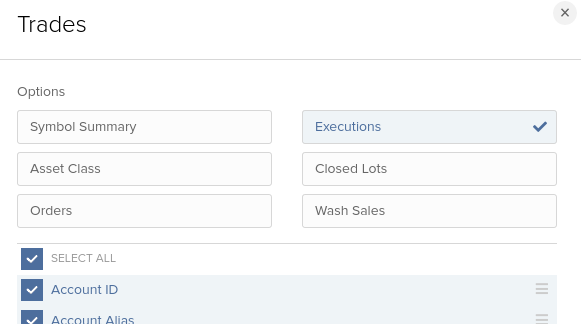  
      
2. Вновь созданный flex-отчет появится в списке *Activity Flex Query*. Его нужно запустить по нажатию на стрелку вправо (команда *Run*).
Формат нужно оставить XML. В качестве периода максимум можно выбрать год — поэтому нужно выполнить отчет несколько раз, чтобы последовательно получить операции за всё время существования счёта.
В результате у вас будет один или несколько XML файлов с отчетами. В качестве примера для дальнейших действий я буду использовать [IBKR_flex_sample.xml](https://cdn.jsdelivr.net/gh/titov-vv/jal/docs/ru-tax-3ndfl/IBKR_flex_sample.xml)  

3. В *jal* все транзакции привязаны к тому или иному счету с определённой валютой. При импорте отчёта Interactive Brokers *jal* создаст нужные счета автоматически (при этом имя счёта будет иметь вид *Номер.Валюта*).
Если счёт с таким номером и валютой уже существует, то *jal* будет использовать его (новый счёт создан не будет). Для учёта операций ввода/вывода средств необходимо добавить ещё один счёт любого типа — его можно создать, когда *jal* спросит о том откуда или куда были переведены средства.  
В примере ниже я создал 2 счёта (как указано выше — этот шаг можно было пропустить):
    - счет типа *Investment*, у которого номер и валюта будут совпадать с номером и валютой счета Interactive Brokers (если бы я этого не сделал, то счёт был бы создан автоматически с именем U1234567.USD).  
Если вы хотите сохранить данные в файл программы 'Декларация', то нужно также указать страну счёта.  
    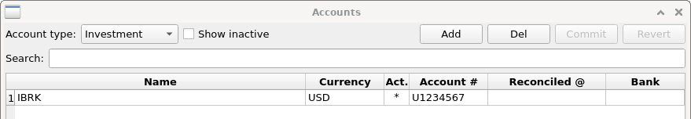   
Так же я указал здесь Interactive Brokers в поле Bank/Broker - это название будет использоваться для учёта сумм удержанных/выплаченных брокером (комиссий, процентов и т.п.).
    - ещё один счет любого типа — он будет необходим для учета транзакций ввода/вывода денежных средств. Например:  
    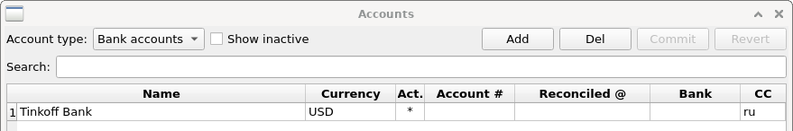  
   
4. Непосредственно для загрузки отчёта вам необходимо выбрать пункт меню *Import->Statement->Interactive Brokers* (в русской версии *Импорт->Выписка->Interactive Brokers*), после чего указать XML файл, который необходимо загрузить.  
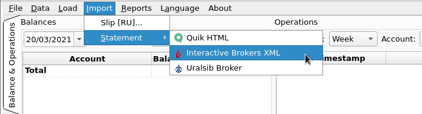  
Если ваш отчет содержит транзакции ввода/вывода денежных средств, то вы *jal* попросит вас указать какой счет нужно использовать для списания/зачисления этих средств (это должен быть другой счёт, отличный от вашего брокерского счёта). Например:   
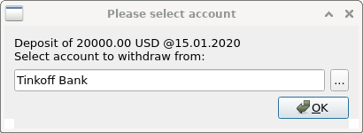  
В случае успешного импорта, вы увидите сообщение *IB Flex-statement loaded successfully* на закладке *Logs* внизу главного окна программы:  
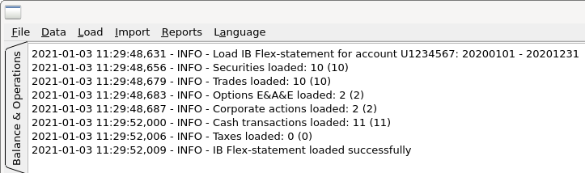
  
5. После инициализации база *jal* содержит 3 валюты - RUB, USD и EUR. Если ваш отчет содержит больше валют, то *jal* добавит символ новой валюты автоматически.  

6. В меню Data -> Peers поменяйте название "Bank for ..." на "Interactive Brokers".
   
7. После загрузки вы можете выбрать полный интервал времени и нужный счёт, чтобы проверить корректность импорта данных:  
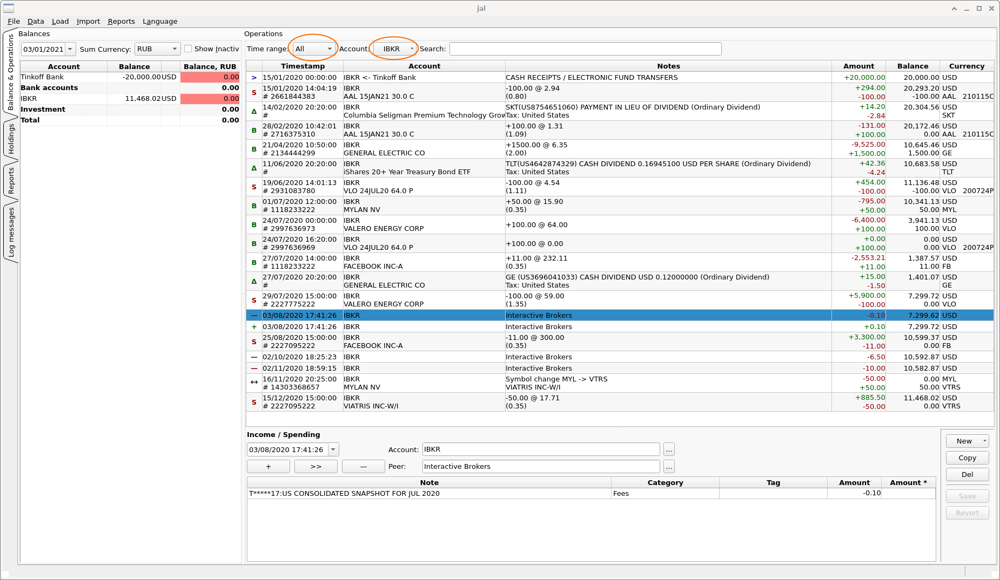
   
   Важно! Нужно импортировать XML не только за отчётный год, но и за последующий. Например, если в 2022 году делаем декларацию за 2021й, то нужно импортировать 2021, а потом 2022 по текущую дату.
   
   Дело в том, что отчет Interactive brokers содержит два вида нужной нам информации о дивидендах:
   1. Дивиденды (Dividends) - дивиденды, которые были вам выплачены.
   2. Уплаченный налог (Withholding tax) - налог, который "у источника" автоматически удержан в США. Для резидентов РФ с подписанной формой W8-BEN это обычно 10%.

   Однако, уплаченный налог досчитывается и пересчитывается после года, к которому он относится. Окончательный пересчет ("корректировка") завершается 15 марта следующего года. 
   
   Например, мы в 2022 году отчитываемся за 2021й. Тогда налог на дивиденды за 2021 год будет досчитан/пересчитан в 2022 году. После 15 марта все корректировки уплаченных налогов будут завершены. Начисленные/возвращенные суммы можно будет увидеть в Activity Report, в секции Withholding tax за 2022 год.
   
   Чтобы Jal учёл корректировки, нужно загрузить в него XML файл не только за отчётный, но и за следующий год, причём сделать это после 15 марта. Тогда Jal для каждого дивиденда за отчётный год найдёт уплаченный налог с учётом окончательных корректировок, сделанных в следующем году.
   
   В налоговую нужно будет подать два годовых отчета об активности:
   - В отчёте за 2021 год будут дивиденды и уплаченный налог за 2021 год (а также корректировки уплаченного налога за 2020 год, но они здесь лишние).
   - В отчёте за 2022 год будут корректировки к уплаченному налогу за 2021й.
   
8. Если ваш отчёт содержит корпоративные действия (особенно Spin-Off), то я рекомендую ознакомиться с [логикой, которая используется *jal* для их обработки](https://github.com/titov-vv/jal/blob/master/docs/ru-tax-3ndfl/corporate_actions.md) и убедиться что вы указали правильную долю выделяемого актива.  
   
9. При подготовке декларации все суммы нужно пересчитать в рубли — для этого необходимо загрузить курсы валют.
Сделать это можно с помощью меню *Import->Download quotes...* (в русской версии *Импорт->Загрузить котировки...*), указав необходимый диапазон дат:  
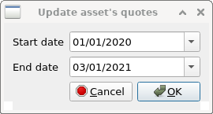
   
10. С помощью *jal* вы можете подготовить как расчёт в виде файла Excel, так и файл для программы *"Декларация"* (расширение файла содержит последнюю цифру года: `.de5` для 2025 года).
Все шаги, связанные с программой *"Декларация"*, являются необязательными и вы можете их пропустить.  
Скриншоты ниже сделаны на демонстрационном счёте с вымышленными данными, поэтому название счёта и бумаги в них отличаются от примера из шагов 1-7.

11. Для выполнения расчёта вам необходимо выбрать пункт меню *Tax->Investment tax report* (в русской версии *Налоги->Инвестиционный налоговый отчет*) и заполнить параметры в появившемся окне:  
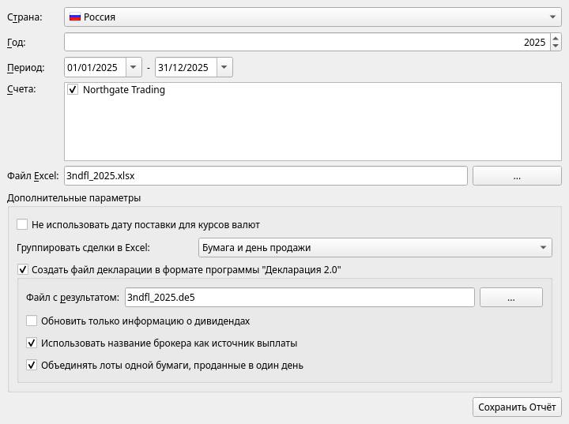  
Вам необходимо задать:
    - *Страна* - Россия
    - *Год*, за который формируется отчёт
    - *Период* - по умолчанию весь год; менять его нужно, только если вы были налоговым резидентом РФ не весь год
    - *Счета* - в списке показаны инвестиционные счета, по которым в выбранном периоде были налогооблагаемые операции. Можно отметить несколько счетов сразу - тогда они попадут в один отчёт, каждый своим блоком, с общим итогом
    - *Файл Excel*, куда будет сохранён расчёт

    Раздел *Дополнительные параметры*:
    - *Не использовать дату поставки для курсов валют* - брать курс ЦБ РФ на дату сделки, а не на дату расчётов
    - *Группировать сделки в Excel* - расчёт ведётся по ФИФО, поэтому одна продажа может занимать несколько строк: по одной на каждую покупку, которую она закрывает. Группировка сворачивает такие строки под одну строку с суммами, ничего не удаляя (см. шаг 12). Варианты: *Бумага и день продажи*, *Бумага*, *Бумага, день покупки и день продажи*. Итоги отчёта от группировки не зависят
    - *Создать файл декларации в формате программы "Декларация 2.0"* - поставьте галочку, если хотите получить файл для программы *"Декларация"*, и укажите его имя в поле *Файл с результатом*. Для этого у счёта нужно указать страну и брокера (см. шаг 3). Внутри этого блока:
        - *Обновить только информацию о дивидендах* - существуют разные практики занесения информации о сделках в декларацию. Если вы не хотите, чтобы сделки попадали в файл, поставьте эту галочку - в файл будет добавлена лишь информация о дивидендах, а суммы по сделкам вы внесёте вручную из итогов расчёта
        - *Использовать название брокера как источник выплаты* - указывать источником дохода брокера, а не эмитента бумаги
        - *Объединять лоты одной бумаги, проданные в один день* - записывать в файл одну строку на все такие лоты вместо строки на каждый лот. У них одна дата получения дохода и один курс, поэтому в строке декларации ничего не теряется, а строк становится меньше. Расчёт в Excel при этом остаётся подробным

    Нажмите кнопку *Сохранить отчёт*. Расчёт занимает некоторое время: *jal* заново проходит всю историю сделок по правилам НК РФ, ход выполнения виден в строке состояния. Если для расчёта не хватает курса валюты или котировки, *jal* остановится и перечислит недостающие даты - загрузите их (шаг 9) и сохраните отчёт снова.

12. [Получившийся Excel-файл с расчётом](https://github.com/titov-vv/jal/blob/master/docs/ru-tax-3ndfl/3ndfl_tax_report.xlsx) содержит по одному листу на каждый вид дохода: *Сводка, Акции, Облигации, ПФИ, Дивиденды, Проценты, Криптовалюты, Криптодоход, Комиссии* и *Не отражено*.
    Лист, для которого не было операций, в файл не попадает. Под заголовком каждого листа перечислены правила, по которым он построен: как сопоставлены сделки, какой курс использован, что считается расходом.
    - *Сводка* - итоги по каждой налоговой базе (ценные бумаги, ПФИ, дивиденды, проценты и т.д.), количество операций, которые не попали ни на один лист, базовая оценка налога и предупреждения. Начинать проверку стоит с этого листа.  
    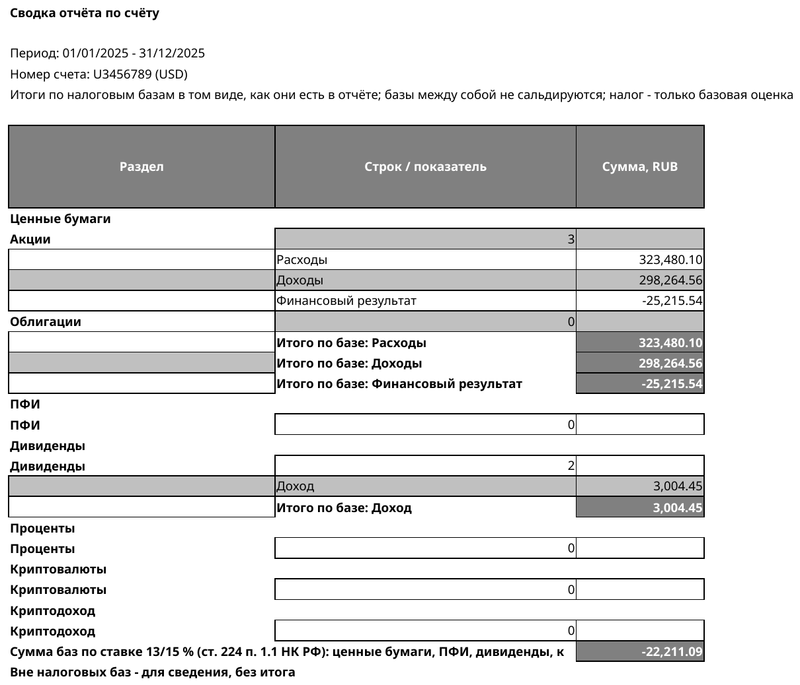
    - *Акции* - сделки с акциями и паями, завершённые в отчётном году. На скриншоте включена группировка *Бумага и день продажи*, а группа раскрыта: строка, выделенная жирным шрифтом, - это сумма по трём лотам, проданным 16/09/2025 двумя сделками; под ней - сами лоты с номерами сделок, по которым их можно сверить с отчётом брокера. В файле группы свёрнуты - их раскрывает значок *+* слева от строки (или кнопка *2* над ним - для всех групп сразу).
    Именно такая строка с суммами попадает в файл декларации, если включено объединение лотов. Листы *Облигации* и *ПФИ* устроены так же (облигации не группируются).  
    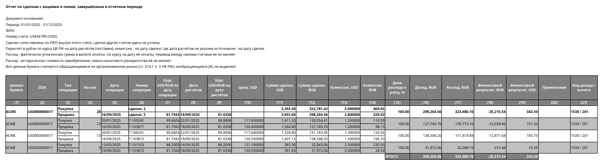
    - *Дивиденды* - дивиденды, налог, удержанный у источника, признак наличия СОИДН и базовая оценка налога к доплате.  
    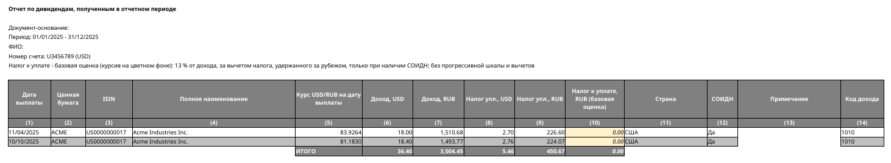  
      Если источником дохода в файле декларации указывается эмитент (галочка *Использовать название брокера как источник выплаты* снята), а страна бумаги не задана, дивиденд по ней не попадёт в файл (сообщение об этом будет в журнале) - укажите страну в справочнике ценных бумаг (меню *Данные*) и сохраните отчёт снова.
    - *Проценты* - проценты, выплаченные брокером, и денежные выплаты по корпоративным событиям; *Комиссии* - комиссии, не связанные со сделками (например, депозитарные). Комиссии не входят ни в одну налоговую базу - учитывать ли их и как, решать вам.
    - *Не отражено* - налогооблагаемые операции, для которых в *jal* пока нет листа, и операции, которые отчёт пропускает по правилу (с указанием причины). Если этот лист есть, его обязательно нужно прочитать: эти операции придётся учесть вручную.

    В последнем столбце каждого листа указан код дохода и код вычета по справочнику ФНС. Суммы, которые являются оценкой *jal*, а не данными брокера (налог к доплате), выделены курсивом на светлом фоне - это ориентир, а не сумма налога к уплате.
    Короткие продажи отражаются в году продажи; короткая позиция по акциям, не закрытая до конца года, показывается без расхода на приобретение, а по остальным инструментам *jal* выдаёт предупреждение и её нужно проверить вручную.
    Подробное описание листов, кодов, базовой оценки, коротких продаж и того, как отчёт трактует обмены и корпоративные события, есть в [руководстве пользователя](https://titov-vv.github.io/jal/manual/11-taxes) (на английском языке).

13. Если вы создавали файл декларации, то теперь можете открыть его с помощью программы *"Декларация"* и проверить, что информация была добавлена на закладку *Доходы за пределами РФ* (скриншот сделан в одной из предыдущих версий программы):  
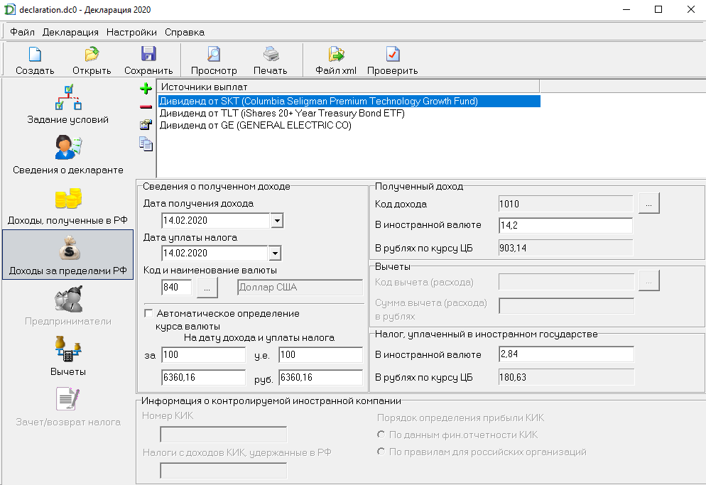  
В файл попадают дивиденды, сделки с акциями, облигациями и ПФИ и проценты; операции с криптовалютой в него пока не записываются.
Сверьте итоги в программе с итогами листов Excel - особенно если вы включали объединение лотов.  
Если часть декларации вы подготовили отдельно (например, в самой программе *"Декларация"* или по каждому счёту в отдельности), файлы можно объединить: пункт меню *Tax->Merge Russian tax files (\*.de5)* (в русской версии *Налоги->Объединить файлы налоговой декларации (\*.de5)*). Добавьте файлы, укажите имя итогового файла и нажмите *OK* - доходы за пределами РФ будут собраны из всех файлов, остальные разделы будут взяты из наиболее полно заполненного файла.
Для счетов, которые ведутся в *jal*, проще отметить их все в одном отчёте (шаг 11).

14. Перед подачей декларации:
    - убедитесь, что загружены курсы валют за весь год (шаг 9) и что на листе *Сводка* нет предупреждений;
    - прочитайте лист *Не отражено*, если он есть;
    - проверьте, что остатки по счёту в *jal* совпадают с отчётом брокера - это признак того, что данные загружены полностью;
    - проверьте корпоративные события (шаг 8);
    - сохраните у себя файлы, которые подаёте: *jal* каждый раз рассчитывает отчёт заново по текущим данным и не хранит копию того, что было сформировано раньше.

    *jal* не является налоговым консультантом: проверьте полученные цифры и то, как они должны быть отражены в декларации, прежде чем её подавать.
